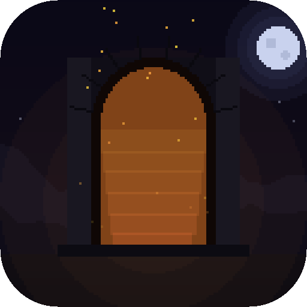
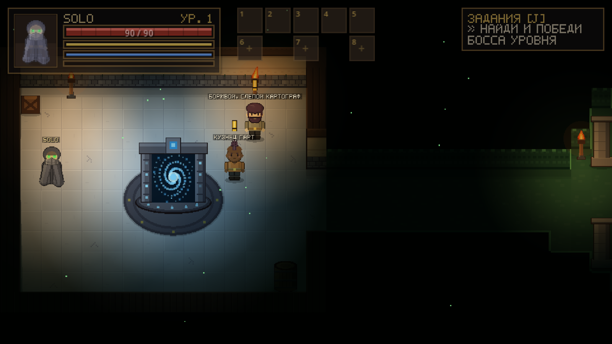
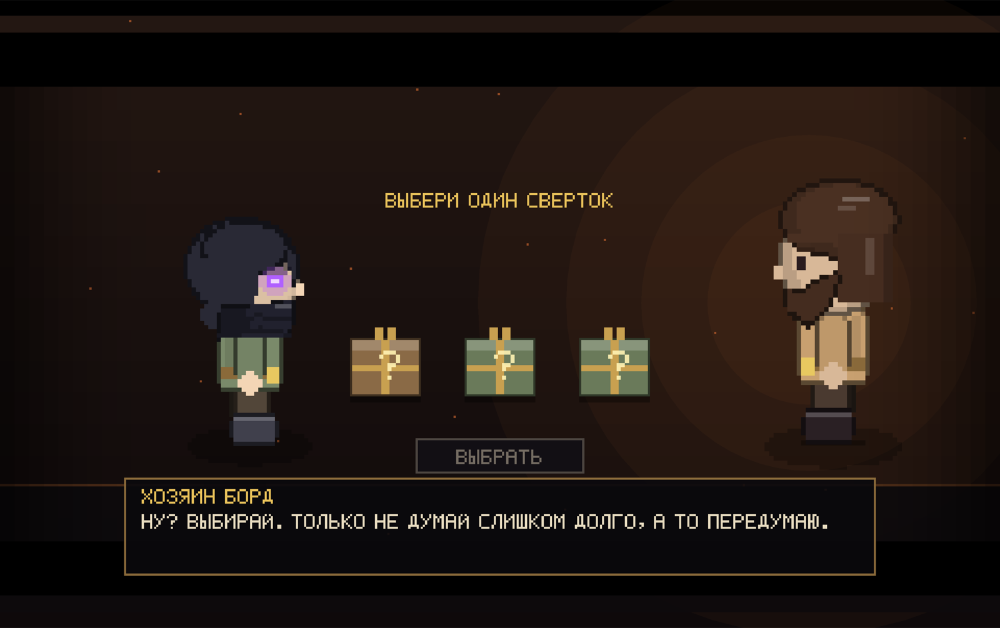
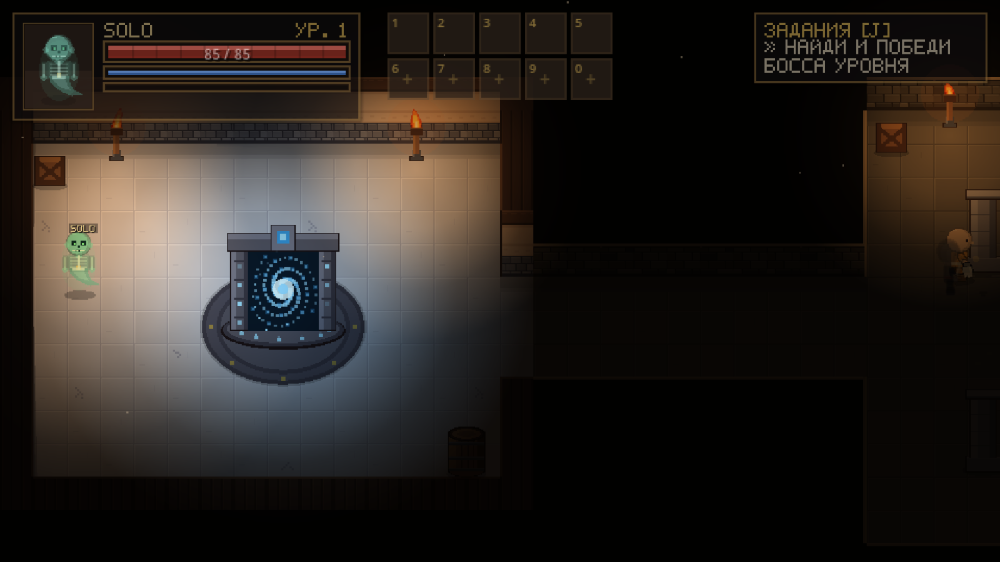

<p align="center">
  
</p>

<h1 align="center">Усталый путник</h1>

<p align="center">
  Пиксельная action-RPG о страннике, который просто хотел передохнуть, а нашёл в таверне портал в подземелья.
  <br>
  <b>Windows · macOS · Linux · Android · браузер</b>
</p>

<p align="center">
  <a href="../../releases/latest"><b>⬇ Скачать последнюю версию</b></a>
  &nbsp;·&nbsp;
  <a href="https://tiredtravelergames.github.io/tired-wanderer/play/"><b>▶ Играть в браузере</b></a>
  &nbsp;·&nbsp;
  <a href="https://tiredtravelergames.github.io/tired-wanderer/"><b>Сайт игры</b></a>
</p>

---



## Об игре

**«Усталый путник»** — пиксельная action-RPG о страннике, который просто хотел передохнуть, а нашёл в таверне портал в подземелья.

Ты еле стоишь на ногах, когда добредаешь до таверны «Усталый путник». Хозяин, Борд, суёт тебе зелья и подарок на дорогу и между делом рассказывает, что внизу, под полом, кишат твари. А посреди зала у него стоит портал, и ведёт он куда глубже подвала.

Так начинается дорога вниз: через катакомбы и склепы, тёмные чащи, огненные пещеры и ледяные залы. Каждый спуск заканчивается стражем, которого надо одолеть, чтобы пройти дальше. Между вылазками ты возвращаешься в таверну, и она меняется вместе с тобой: люди, которых ты вытащил из подземелий, остаются здесь, обживаются и помогают.

Можно идти одному, а можно позвать друзей: кооператив до четырёх игроков.

| | |
|---|---|
|  |  |

## Особенности

- **Живой бой.** Цепочки ударов, блок и парирование щитом, увороты, стрельба. Каждый враг бьёт по-своему, и у каждого стража свой характер.
- **Десять классов.** Воин, Лучник, Страж, Плут, Паладин, Маг, Некромант, Жрец, Друид и Бродяга. Выбирай путь в таверне, осваивай новые со временем и развивай героя по звёздному дереву умений.
- **Снаряжение и кузня.** Оружие, броня, щиты, кольца и амулеты. Улучшай, чини и усиливай любимый клинок.
- **Подземелья с секретами.** Запертые арены, засады, головоломки, ловушки и тайники для тех, кто смотрит внимательно.
- **Истории и случайности.** Встречи, задания, странные события, где исход решает бросок кубика.
- **Вместе веселее.** Кооператив до четырёх игроков по сети: общие задания и опыт, и упавшего друга всегда можно поднять.
- **Таверна — твой дом.** Её можно отстроить, у её обитателей есть свои истории, а у героя своя внешность.

## Установка

Всё скачивается со страницы [Releases](../../releases/latest).

**Windows.** Скачай `TiredWanderer.exe` и просто запусти его: игра в одном файле, установка не нужна. Если SmartScreen предупреждает о неизвестном издателе, нажми «Подробнее» → «Выполнить в любом случае».

**macOS** (Apple Silicon и Intel). Открой `TiredWanderer-macos.dmg` и перетащи игру в папку «Программы». Приложение не подписано сертификатом Apple, поэтому при первом запуске macOS напишет, что оно «повреждено». Это не так: открой Терминал и выполни команду, после неё игра запускается как обычно.

```bash
xattr -cr /Applications/TiredWanderer.app
```

**Linux** (x86_64). Распакуй `TiredWanderer-linux.zip`, сделай файл исполняемым (`chmod +x TiredWanderer.x86_64`) и запусти.

**Android.** Скачай `TiredWanderer-android.apk` на телефон и открой его. Если Android спросит, разреши установку из этого источника.

**Браузер и iPhone.** [Играй прямо в браузере](https://tiredtravelergames.github.io/tired-wanderer/play/), без установки. На iPhone и iPad открой ссылку в Safari и выбери «Поделиться» → «На экран Домой»: игра будет открываться как приложение. В браузере доступна одиночная игра.

## Управление

| Действие | Клавиша |
|---|---|
| Движение | W A S D |
| Атака (комбо) / тяжёлый удар | ЛКМ / удержание ЛКМ |
| Блок щитом, выстрел из лука или посоха | ПКМ |
| Уворот | Пробел + направление |
| Приёмы класса | 6, 7, 8, 9, 0 |
| Взаимодействие, подбор, диалог | E (поднять союзника: удерживать E) |
| Инвентарь / журнал / карта / умения | I / J / M / K |
| Быстрые слоты | 1-5 |
| Пауза / закрыть окно | Esc |
| Полный экран / окно | F11 или Alt+Enter |

## Сенсорное управление

На телефонах и планшетах управление появляется само: джойстик слева (касание в любом месте левой части экрана), справа кнопки удара, блока, рывка, действия и приёмов, сбоку кнопки инвентаря, умений, карты, журнала и паузы. Зелья пьются касанием по быстрым слотам вверху. Атаки и приёмы сами наводятся на ближайшего врага.

## Кооператив

Доступен в версиях для Windows, macOS, Linux и Android.

1. Хост выбирает «Создать игру (Host)».
2. Остальные выбирают «Присоединиться» и вводят IP хоста.
3. Хост нажимает «Старт».

В одной сети Wi-Fi ничего настраивать не нужно. Через интернет хосту нужен проброс порта **7777 (UDP)** на роутере, либо все игроки подключаются к общей виртуальной сети (Tailscale, Radmin VPN, ZeroTier).

## Права

© 2026 tiredtravelergames. Все права защищены. Игру можно бесплатно скачивать и играть; копирование, изменение и распространение файлов игры без разрешения автора не допускаются.
